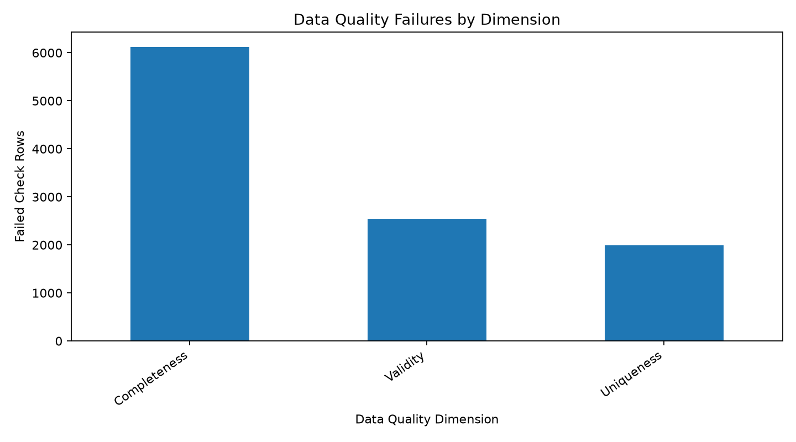

# Transaction Data Quality Report

## 1. Overview

- **Rows scanned:** 51,000
- **Transaction date range:** 2025-01-01 to 2027-01-22
- **Report generation time:** 9.10 seconds

## 2. Overall Data Quality

- **Clean rows:** 43,678
- **Total rows used for score:** 51,000
- **Data quality score:** 85.64%
- **Score calculation basis:** Rows without ground_truth_issue_flag

Note: the score reflects the stated calculation basis, not necessarily every quality check in the project.

## 3. Results by Dimension

- **Completeness:** 6,123 failed check rows
- **Validity:** 2,538 failed check rows
- **Uniqueness:** 1,988 failed check rows

The counts above are summed across checks. A single transaction may fail multiple checks.

## 4. Top Data Quality Issues

- **Missing amount** — High severity; 2,545 failed rows (4.99%).
- **Duplicate transaction IDs** — High severity; 1,000 failed rows (1.96%).
- **Non-positive amount** — High severity; 100 failed rows (0.20%).
- **Missing transaction ID** — High severity; 0 failed rows (0.00%).
- **Missing customer ID** — Medium severity; 1,535 failed rows (3.01%).
- **Exact duplicates** — Medium severity; 988 failed rows (1.94%).
- **Invalid currency** — Medium severity; 100 failed rows (0.20%).
- **Invalid status** — Medium severity; 100 failed rows (0.20%).
- **Future transaction dates** — Medium severity; 95 failed rows (0.19%).
- **Invalid payment method** — Medium severity; 0 failed rows (0.00%).

## 5. Anomaly Highlights

**Transaction: TXN006064**
- Customer: CUST00645
- Amount: INR 9,996.80
- Detection reasons: Iqr, Near Limit, Late Night, First Transaction, Other Rules

**Transaction: TXN003947**
- Customer: CUST00234
- Amount: GBP 9,998.48
- Detection reasons: Iqr, Near Limit, Late Night, First Transaction, Other Rules

**Transaction: TXN037457**
- Customer: CUST04442
- Amount: INR 900,000.00
- Detection reasons: Iqr, Group, Round Amount, First Transaction, Other Rules

**Transaction: TXN038164**
- Customer: CUST02126
- Amount: EUR 9,998.90
- Detection reasons: Iqr, Near Limit, Late Night, First Transaction, Other Rules

**Transaction: TXN026982**
- Customer: CUST01882
- Amount: INR 900,000.00
- Detection reasons: Iqr, Group, Round Amount, First Transaction, Other Rules

**Transaction: TXN001058**
- Customer: CUST07722
- Amount: INR 900,000.00
- Detection reasons: Iqr, Group, Round Amount, Other Rules

**Transaction: TXN013354**
- Customer: CUST04357
- Amount: INR 9,994.93
- Detection reasons: Iqr, Near Limit, First Transaction, Other Rules

**Transaction: TXN002270**
- Customer: CUST09767
- Amount: USD 4,051.95
- Detection reasons: Iqr, Late Night, First Transaction, Other Rules

**Transaction: TXN008126**
- Customer: CUST01616
- Amount: INR 9,997.10
- Detection reasons: Iqr, Near Limit, First Transaction, Other Rules

**Transaction: TXN009180**
- Customer: nan
- Amount: INR 900,000.00
- Detection reasons: Iqr, Group, Round Amount, Other Rules

The transactions above are flagged for review. An anomaly is not automatically a confirmed error or fraud.

## 6. Recommendations

- Require customer IDs when transactions are submitted.
- Enforce transaction ID uniqueness where required by the business rules.
- Validate email formats before saving records.
- Validate transaction amounts and permitted currencies.
- Investigate repeated high-value or unusual transactions.
- Review flagged records before taking corrective action.

## 7. Limitations

- Quality rules and anomaly thresholds may require tuning.
- Anomaly detection can produce false positives and false negatives.
- Detector flags identify records for review, not confirmed fraud.
- The overall score depends on the checks and labels used in its calculation.
- The detail sheets use the specific rules implemented in this report script.
